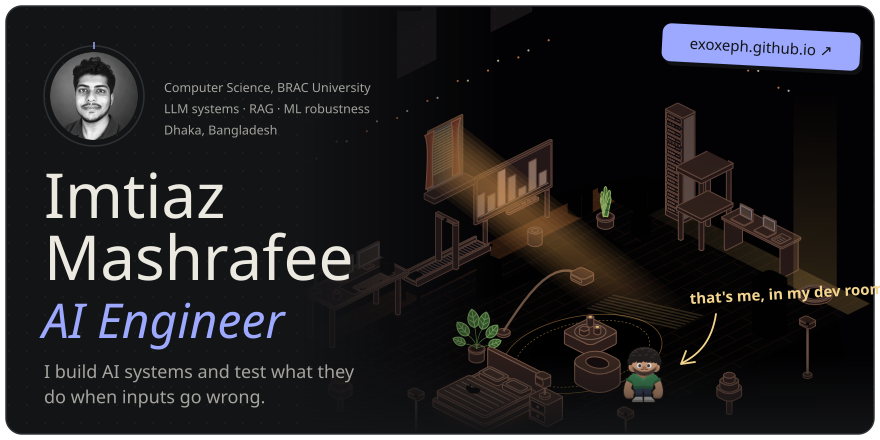
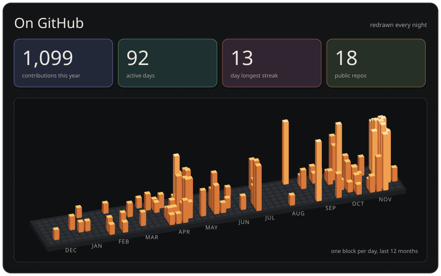
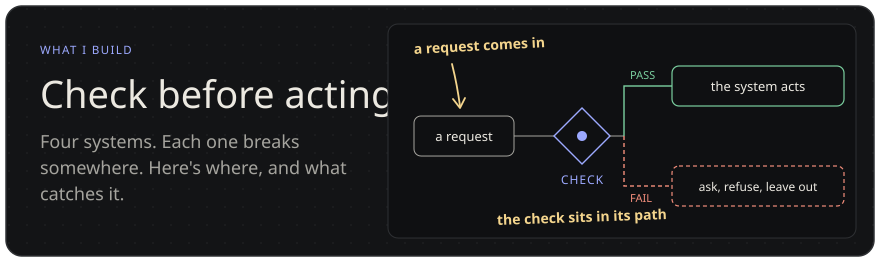
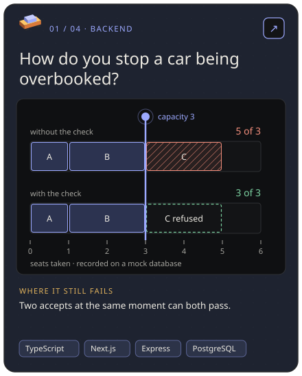
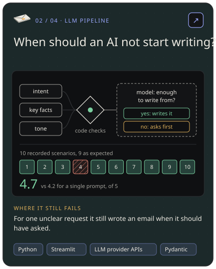
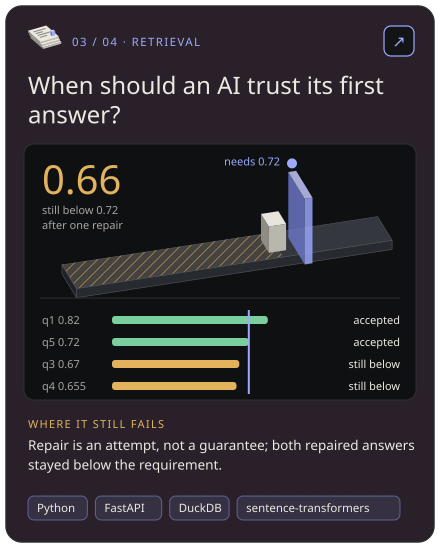
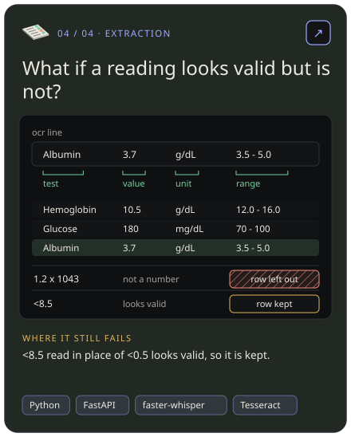
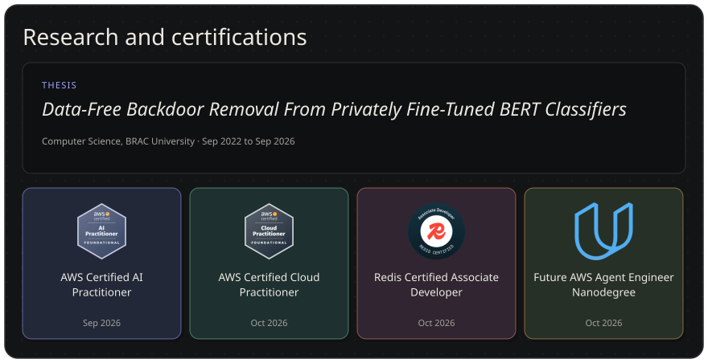
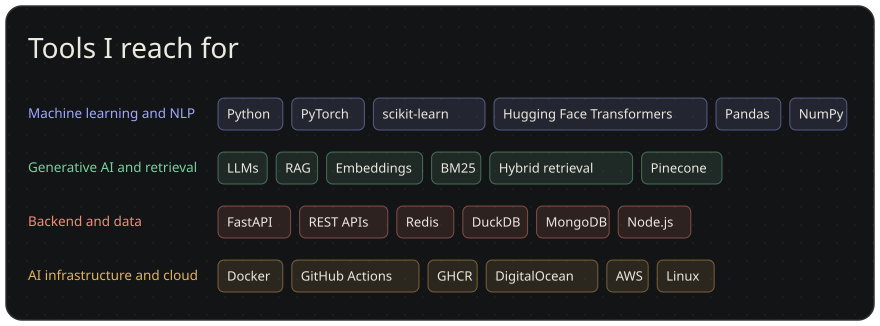

<a href="https://imtiazmashrafee.pages.dev"><picture><source media="(max-width: 600px)" srcset="assets/hero-phone.svg"></picture></a>

<picture><source media="(max-width: 600px)" srcset="assets/github-phone.svg"></picture>

<picture><source media="(max-width: 600px)" srcset="assets/whoami-phone.svg"></picture>

<a href="https://imtiazmashrafee.pages.dev"><picture><source media="(max-width: 600px)" srcset="assets/idea-phone.svg"></picture></a>

<a href="https://imtiazmashrafee.pages.dev/work/ride-pooling-lifecycle/"><picture><source media="(max-width: 600px)" srcset="assets/project-ride-pooling-lifecycle-phone.svg"></picture></a>
<a href="https://imtiazmashrafee.pages.dev/work/llm-email-pipeline/"><picture><source media="(max-width: 600px)" srcset="assets/project-llm-email-pipeline-phone.svg"></picture></a>
<a href="https://imtiazmashrafee.pages.dev/work/retrieval-orchestration/"><picture><source media="(max-width: 600px)" srcset="assets/project-retrieval-orchestration-phone.svg"></picture></a>
<a href="https://imtiazmashrafee.pages.dev/work/speech-document-extraction/"><picture><source media="(max-width: 600px)" srcset="assets/project-speech-document-extraction-phone.svg"></picture></a>

Each card opens its case study. The code: <a href="https://github.com/exoxeph/tesla-pool">tesla-pool</a> · <a href="https://github.com/exoxeph/email-assistant">email-assistant</a> · <a href="https://github.com/exoxeph/Data-Aware-RAG">Data-Aware-RAG</a> · <a href="https://github.com/exoxeph/speech-doc-extraction">speech-doc-extraction</a>

<picture><source media="(max-width: 600px)" srcset="assets/creds-phone.svg"></picture>

Verify: <a href="https://www.credly.com/badges/f877a355-f105-4953-9784-0ebedbeda19e/linked_in_profile">AWS Certified AI Practitioner</a> · <a href="https://www.credly.com/badges/1be73443-89e4-4657-96c6-d4fa99cf607b/">AWS Certified Cloud Practitioner</a> · <a href="https://credentials.redis.io/9db642ab-2b59-46db-8a85-e6ec3a36a18a">Redis Certified Associate Developer</a> · <a href="https://www.udacity.com/certificate/e/be79146e-900d-11f1-84b6-df558e132a0d">Future AWS Agent Engineer Nanodegree</a>

<picture><source media="(max-width: 600px)" srcset="assets/stack-phone.svg"></picture>

Drawn in the design system of <a href="https://imtiazmashrafee.pages.dev">imtiazmashrafee.pages.dev</a> · GitHub numbers redrawn every night by a GitHub Action

