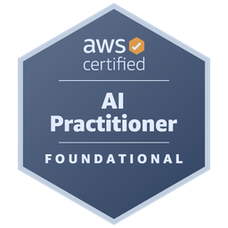
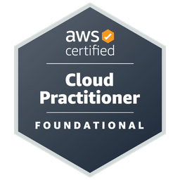
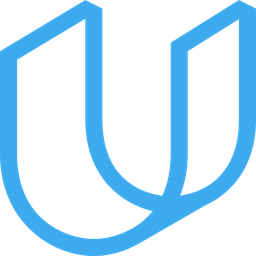
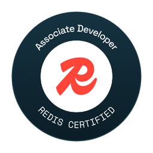

```
██╗███╗   ███╗████████╗██╗ █████╗ ███████╗   ███╗   ███╗ █████╗ ███████╗██╗  ██╗██████╗  █████╗ ███████╗███████╗███████╗
██║████╗ ████║╚══██╔══╝██║██╔══██╗╚══███╔╝   ████╗ ████║██╔══██╗██╔════╝██║  ██║██╔══██╗██╔══██╗██╔════╝██╔════╝██╔════╝
██║██╔████╔██║   ██║   ██║███████║  ███╔╝    ██╔████╔██║███████║███████╗███████║██████╔╝███████║█████╗  █████╗  █████╗
██║██║╚██╔╝██║   ██║   ██║██╔══██║ ███╔╝     ██║╚██╔╝██║██╔══██║╚════██║██╔══██║██╔══██╗██╔══██║██╔══╝  ██╔══╝  ██╔══╝
██║██║ ╚═╝ ██║   ██║   ██║██║  ██║███████╗   ██║ ╚═╝ ██║██║  ██║███████║██║  ██║██║  ██║██║  ██║██║     ███████╗███████╗
╚═╝╚═╝     ╚═╝   ╚═╝   ╚═╝╚═╝  ╚═╝╚══════╝   ╚═╝     ╚═╝╚═╝  ╚═╝╚══════╝╚═╝  ╚═╝╚═╝  ╚═╝╚═╝  ╚═╝╚═╝     ╚══════╝╚══════╝
```

<p align="center">
  
</p>

```bash
visitor@github:~$ cat ./about_me.txt

  Name    : Imtiaz Mashrafee
  Handle  : exoxeph
  Uni     : BRAC University
  Focus   : AI · LLMs · RAG · Backend Systems
  Status  : [██████████  ]  Learning every day
  Collab  : OPEN, reach out anytime ✅
```

<br>

<p align="left">
  
</p>

---

I'm Imtiaz, an AI engineer based in Dhaka, Bangladesh.

I build backend systems and LLM-powered tools: RAG pipelines, vector search, and the infrastructure that keeps them running.

If a paper or idea catches my eye, there's a good chance I'll have a working prototype by the weekend.

I'm currently a Backend AI Engineering Intern @ FlyRank AI, and previously worked as an AI & DevOps Engineering Intern @ Data Solution-360, where I helped ship LinkX360's deployment pipeline on DigitalOcean and built Redis-backed async systems.

I've got a few pinned projects, but my favorite is [Data-Aware RAG](https://github.com/exoxeph/Data-Aware-RAG), a production-grade retrieval-augmented generation system for querying research papers.

I'm finishing my CS degree at BRAC University, with a thesis on backdoor attacks and model robustness in neural networks, and I'm an AWS Certified AI Practitioner who completed Udacity's Future AWS Agent Engineer nanodegree.

**Fun Facts:**
- Barça til I die, Visca Barça ⚽
- Currently open to Software Engineering & AI roles
- Hobbies: LLMs, football, and building things that ship

<br>

<p align="left">
  
</p>

---

- **LLM Systems & RAG**: retrieval pipelines, vector search, embeddings
- **Backend & Infra**: Docker, CI/CD, Redis, DigitalOcean deployments
- **ML Security & Robustness**: adversarial/backdoor attacks (thesis focus)
- **Full-Stack when needed**: MERN/Next.js for shipping end-to-end products

<br>

<p align="left">
  
</p>

---

| Skill | Status |
|---|---|
| 🚀 RAG & LLM Systems | ⚡ Active |
| ⚙️ Backend Architecture (Docker, Redis) | ⚡ Active |
| ☁️ Cloud Deployment (DigitalOcean, AWS) | 📘 Learning |
| 🧩 Full-Stack (MERN & Next.js) | ⚡ Active |

<br>

<p align="left">
  
</p>

---

```js
current = {
  "shipping"    : "Production RAG pipelines for research paper retrieval",
  "maintaining" : "Backend AI systems @ FlyRank AI",
  "infra"       : "Redis-backed async systems & Docker deployment pipelines",
  "research"    : "Backdoor attacks & model robustness in neural networks (thesis)",
}
```

<br>

<p align="left">
  
</p>

---

<p align="center">
  <a href="https://github.com/exoxeph">
    
  </a>
  
</p>
<p align="center">
  
</p>
<p align="center">
  
</p>

<br>

<p align="left">
  
</p>

---

<table align="center">
  <tr>
    <td align="center"><b>AI / ML</b></td>
    <td>
      
      
      
      
      
      
    </td>
  </tr>
  <tr>
    <td align="center"><b>Frontend</b></td>
    <td>
      
      
      
    </td>
  </tr>
  <tr>
    <td align="center"><b>Backend</b></td>
    <td>
      
      
      
    </td>
  </tr>
  <tr>
    <td align="center"><b>Databases</b></td>
    <td>
      
      
      
    </td>
  </tr>
  <tr>
    <td align="center"><b>DevOps & Cloud</b></td>
    <td>
      
      
      
    </td>
  </tr>
  <tr>
    <td align="center"><b>Tools</b></td>
    <td>
      
      
      
    </td>
  </tr>
</table>

<p align="center">
  <a href="https://github.com/exoxeph">
    
  </a>
</p>

<br>

<p align="left">
  
</p>

---

<table width="100%">
  <tr>
    <td width="50%" valign="top">
      <h3>🔢 <a href="https://github.com/exoxeph/mnist-digit-recognition-workbench">MNIST Workbench</a></h3>
      <p><b>Progressive Digit Recognition</b></p>
      <p>Four models from a logistic regression baseline to a 98.45%-accurate PyTorch CNN, with a robustness suite testing rotation, blur, noise, and pixel-shift attacks, plus a live Streamlit drawing demo.</p>
      
      
      
    </td>
    <td width="50%" valign="top">
      <h3>📧 <a href="https://github.com/exoxeph/email-spam-classification">Spam Classifier</a></h3>
      <p><b>Progressive Email Spam Detection</b></p>
      <p>A four-version classifier built on the Enron dataset (28k emails): TF-IDF/Naive Bayes baseline, engineered features, tuned model comparison, and a production-style Streamlit risk-triage UI reaching 98.9% F1.</p>
      
      
      
    </td>
  </tr>
  <tr>
    <td width="50%" valign="top">
      <h3>✉️ <a href="https://github.com/exoxeph/email-assistant">Email Assistant</a></h3>
      <p><b>LLM Email Drafting Pipeline</b></p>
      <p>Compares a single-prompt LLM baseline against a two-stage pipeline (intent normalization, contradiction detection, clarification routing, fact filtering) for drafting professional emails from intent/tone inputs.</p>
      
      
      
    </td>
    <td width="50%" valign="top">
      <h3>📚 <a href="https://github.com/exoxeph/Data-Aware-RAG">Data-Aware RAG</a></h3>
      <p><b>Research Paper RAG System</b></p>
      <p>Production-grade RAG pipeline: marker-pdf ingestion into DuckDB, hybrid vector and BM25 retrieval, a FastAPI service with CLI tools, and a 3-tier caching layer for fast repeat queries.</p>
      
      
      
    </td>
  </tr>
  <tr>
    <td colspan="2" valign="top">
      <h3>🏢 <a href="https://github.com/exoxeph/client-management">ClientManager Pro</a></h3>
      <p><b>AI-Powered MERN Client Platform</b></p>
      <p>MERN client-management platform for dev firms: onboarding, proposals, and negotiation, plus an AI RAG layer for codebase analysis using Gemini and Pinecone.</p>
      
      
      
    </td>
  </tr>
</table>

<br>

<p align="left">
  
</p>

---

<table width="100%">
  <tr>
    <td width="50%" align="center" valign="top">
      <a href="https://www.credly.com/badges/f877a355-f105-4953-9784-0ebedbeda19e/linked_in_profile">
        
      </a>
      <h3><a href="https://www.credly.com/badges/f877a355-f105-4953-9784-0ebedbeda19e/linked_in_profile">AWS Certified AI Practitioner</a></h3>
      <p>Amazon Web Services<br>Issued Sep 2026 · Expires Sep 2029</p>
    </td>
    <td width="50%" align="center" valign="top">
      <a href="https://www.credly.com/badges/1be73443-89e4-4657-96c6-d4fa99cf607b/">
        
      </a>
      <h3><a href="https://www.credly.com/badges/1be73443-89e4-4657-96c6-d4fa99cf607b/">AWS Certified Cloud Practitioner</a></h3>
      <p>Amazon Web Services<br>Issued Oct 2026 · Expires Oct 2029</p>
    </td>
  </tr>
  <tr>
    <td width="50%" align="center" valign="top">
      <a href="https://www.udacity.com/certificate/e/be79146e-900d-11f1-84b6-df558e132a0d">
        
      </a>
      <h3><a href="https://www.udacity.com/certificate/e/be79146e-900d-11f1-84b6-df558e132a0d">Future AWS Agent Engineer Nanodegree</a></h3>
      <p>Udacity<br>Completed Oct 2026</p>
    </td>
    <td width="50%" align="center" valign="top">
      <a href="https://credentials.redis.io/9db642ab-2b59-46db-8a85-e6ec3a36a18a">
        
      </a>
      <h3><a href="https://credentials.redis.io/9db642ab-2b59-46db-8a85-e6ec3a36a18a">Redis Certified: Associate Developer</a></h3>
      <p>Redis<br>Issued Oct 2026 · Expires Oct 2028</p>
    </td>
  </tr>
</table>

<br>

<p align="left">
  
</p>

---

<p align="center">
  <a href="https://www.linkedin.com/in/imtiazmashrafee/"></a>&nbsp;&nbsp;
  <a href="mailto:imtiazmashrafee@gmail.com"></a>&nbsp;&nbsp;
  <a href="https://wa.me/3871726493223"></a>
</p>

<br>

<p align="left">
  
</p>

---

> 99 little bugs in the code, 99 little bugs... take one down, patch it around, 127 little bugs in the code

<p align="center">
  
</p>


